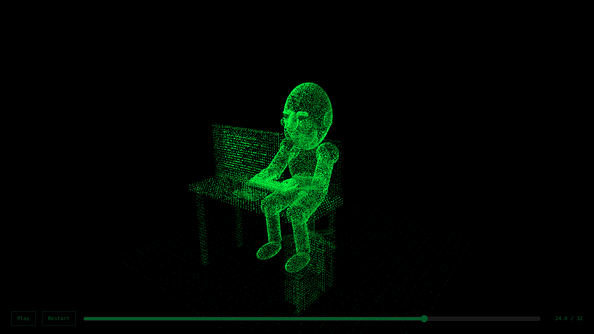
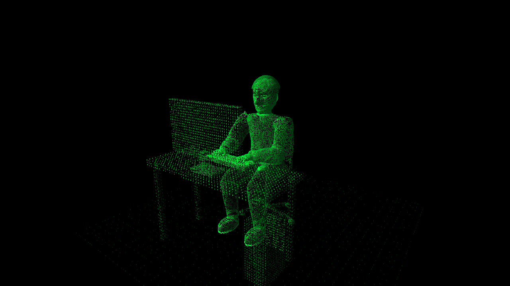
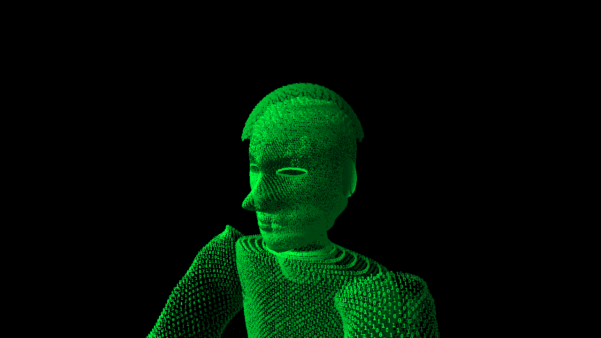
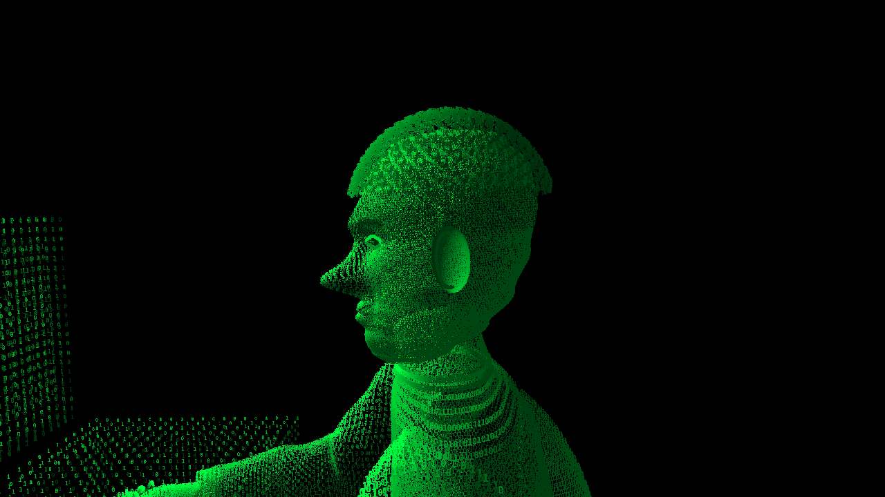
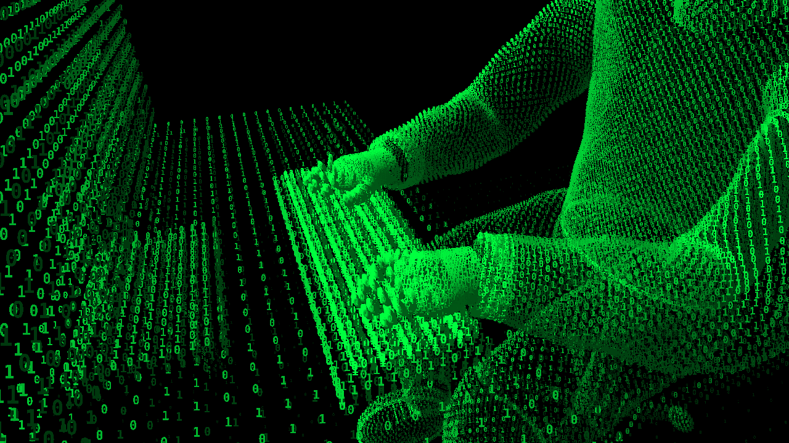

# Binary Mind Odyssey — revisione mirata 2

Candidato per la valutazione artistica dell'utente. Il concept e gli otto generatori dei mondi approvati sono conservati; nessuna integrazione nel profilo è stata eseguita.

## Personaggio originale

La figura precedente aveva una testa sproporzionata, lineamenti costruiti con ellissoidi sovrapposti e arti quasi cilindrici. Il nuovo personaggio è un giovane adulto originale, sviluppato per il riferimento afrodiscendente richiesto, con ricci corti, lineamenti più naturali e abbigliamento contemporaneo senza marchi. La monocromia rimane rigorosamente verde su nero.

- Volto continuo con orbite incavate, palpebre, iride e pupilla, ponte e ali nasali, labbra e mandibola; normali ottenute dalle derivate della superficie.
- Proporzioni testa/spalle corrette; collo inclinato verso il monitor, raccordo delle spalle e felpa con scollo e polsini.
- Maniche e pantaloni costruiti lungo curve cubiche, con sezioni variabili e pieghe discrete; nessuna giunzione a sfera esposta.
- Mani con dita articolate geometricamente sopra i tasti, pollici distinti, seduta, gambe e scarpe riposizionate.
- Capelli a piccole spirali tridimensionali aderenti alla calotta; orecchie con depressione interna.
- Nessun modello scaricato, asset proprietario, volto di una persona reale o materiale da videogiochi.

Tutte queste superfici sono campionate in posizioni XYZ di glifi: non viene disegnata una mesh piena sotto il testo.

## Confronto

| Prima | Revisione 2 |
|---|---|
|  |  |

Le immagini sono diagnostica del programma, non fotogrammi usati per riprodurre l'animazione.

## Ritmo e continuità

Durata: **28 s**, rispetto ai precedenti 32 s. La parte in movimento passa da 28 a 24 s: velocità aumentata del 16,7%, durata ridotta del 14,3%. Restano 3,5 s di firma completamente composta e 0,5 s di dissolvenza.

Il nuovo cranio contiene l'universo a scala 0,0038 (raggio massimo 0,1292). La camera è ricalibrata per attraversare lo stesso universo, uscire dalla testa e mostrare la postazione senza tagli. Geometrie scientifiche, morphing e movimenti di orbite/ingranaggi sono conservati.

Nel passaggio dal creatore alla firma vengono conservati anche identità dei glifi, semi di dissolvenza, dimensioni, densità e luminosità delle diverse parti. Questo evita una sostituzione visibile quando comincia il morph.

Non sono state aggiunte particelle decorative o nuovi oggetti mobili: dopo il confronto visivo ho mantenuto gli spazi liberi e la gerarchia dei soggetti. I dettagli aggiuntivi riguardano il personaggio e la sedia.

## Anteprima e verifica finale

- [Scarica il programma autonomo aggiornato](https://github.com/Tire-C/Tire-C/raw/217afe545d26d6dee2c855e5634b9a1e46ddb0ce/odyssey/review/odyssey.html). Aprire il singolo HTML nel browser; GitHub lo serve come file, non come sito. Pages non è attivo per questa revisione.
- [Codice sorgente verificato](https://github.com/Tire-C/Tire-C/tree/367b3066d022ebe6e1a9537de77f794926d4e297/odyssey/src).
- [Esecuzione cloud](https://github.com/Tire-C/Tire-C/actions/runs/43592033689), [rapporto strutturato](diagnostics/report.json), [galleria della timeline](diagnostics/README.md).
- Source SHA: `367b3066d022ebe6e1a9537de77f794926d4e297`; output SHA: `217afe545d26d6dee2c855e5634b9a1e46ddb0ce`.
- **51 controlli superati**, nessun fallimento. 28 momenti della timeline acquisiti, più primi piani, tre viste orbitali, formato verticale e scene su altri browser.
- Continuità della camera su tutta la durata, determinismo dei pixel, riproduzione/pausa, ispezione orbitale e ritorno all'inquadratura, funzionamento autonomo senza rete, reduced motion e margini della firma verificati.
- Il confronto immediatamente prima/dopo l'ingresso nel morph finale misura **zero differenza media di canale verde**. Identità e aspetto dei glifi restano continui.
- Al massimo 4 draw call nelle acquisizioni; una sola durante l'immersione. Le parti ancora invisibili non vengono più inviate al rendering.
- Testa: 24,712 campioni; corpo: 30,814; postazione: 20,363. Sono dati descrittivi, non un voto artistico.

Ho confrontato visivamente la versione iniziale con entrambi i passaggi di rifinitura del personaggio. La prima passata mostrava occhi troppo marcati, naso appuntito, spalle spigolose e un bordo dei capelli troppo staccato: sono stati corretti prima di questa consegna. Nella versione finale ho osservato frontalmente e di profilo i lineamenti, il raccordo collo/spalle, le dita sui tasti, il corpo seduto da più direzioni, gli ambienti atomico e neurale, più istanti della rivelazione e la firma desktop/verticale.

## Limiti residui e compatibilità

**Rendering software, non GPU fisica.** Chromium usa ANGLE SwiftShader sul runner CPU; mediana 289.4 ms e p95 340.5 ms con lettura effettiva dei pixel nel benchmark del viaggio. Non è un frame rate fluido e non misura quello della GPU dello spettatore.

Firefox ha renderizzato la scena con llvmpipe/Xvfb; WebKit ha renderizzato la scena nel runner. La stringa “Apple GPU” esposta da WebKit non dimostra la disponibilità di hardware Apple o di una GPU reale. La suite completa riguarda Chromium; sugli altri motori è stata verificata la scena del creatore.

Il personaggio resta una scultura binaria stilizzata. I lineamenti perdono dettaglio nelle inquadrature lontane e sui display verticali piccoli; l'ispezione 3D permette di avvicinarsi. L'accettazione del risultato artistico e dell'identità visiva richiesta rimane dell'utente.

La prova SVG dichiarativa continua ad animarsi nel vero rendering Markdown GitHub, senza JavaScript. Questo non rende incorporabile il motore WebGL nel README e non dimostra una sua equivalenza artistica in SVG. Il profilo non contiene alcun compromesso aggiunto automaticamente.

Per tornare alla prima versione si può preparare sul solo branch sperimentale un commit inverso delle modifiche di revisione rispetto a `1252ca823180a84221bac03bcdc55cd334d5b283`, confrontando prima eventuali lavori successivi e rieseguendo i test cloud. Non è necessario modificare main o riscrivere la cronologia.

## Ambiente e protezioni

Installazioni, build, test e acquisizioni esclusivamente su runner standard pubblico GitHub Actions `ubuntu-24.04`. Nessun comando locale, servizio a pagamento, fatturazione o Pages attivato.

Il browser dello spettatore svolge soltanto la normale visualizzazione WebGL. L'HTML è autonomo e non richiede installazioni, server o build.

Il README root e main restano invariati:
- main: `0f00154f3651c7bed8cf8660780bb3c1750ed9bc`
- blob README: `1d0114fe01e78f186042fc760e37b66d6cf9c090`
- SHA-256 README: `f1abfb3998faf6b417398d8755de720779cc0b874e667d113a4134c207673b3e`

Il prototipo e la prima versione restano recuperabili dalla cronologia. L'eventuale integrazione richiede approvazione separata e seguirà la [procedura di aggiunta e ripristino](integration/PROPOSAL.md), preservando byte per byte il contenuto preesistente.
