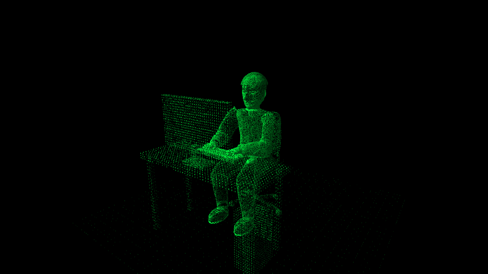
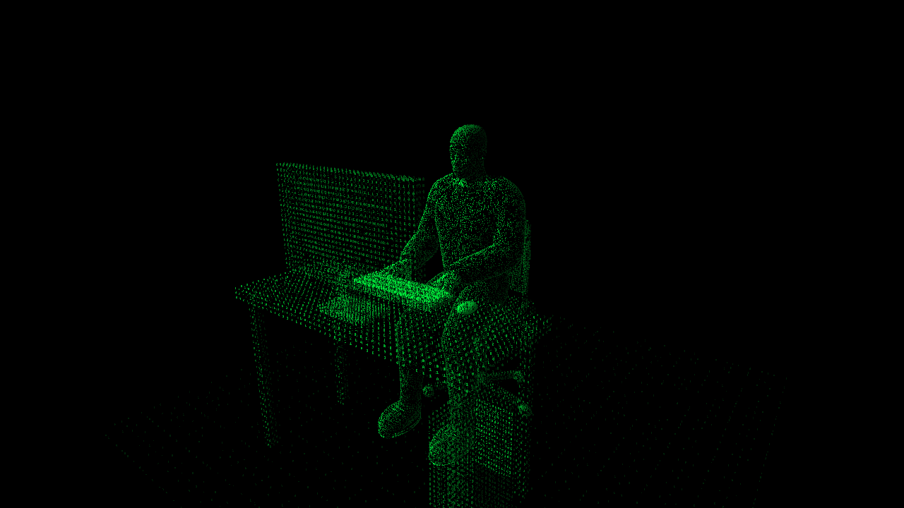
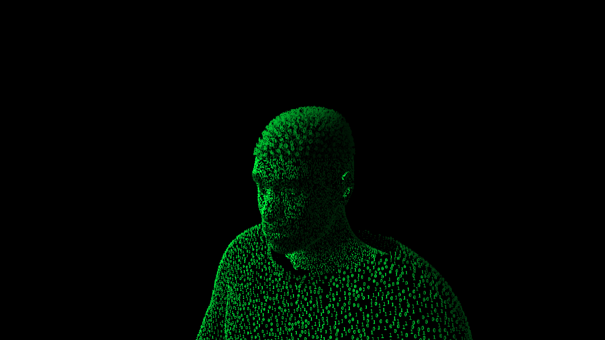
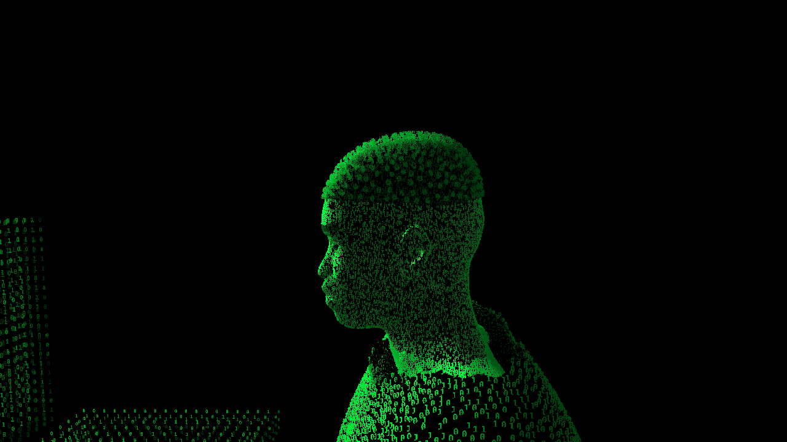
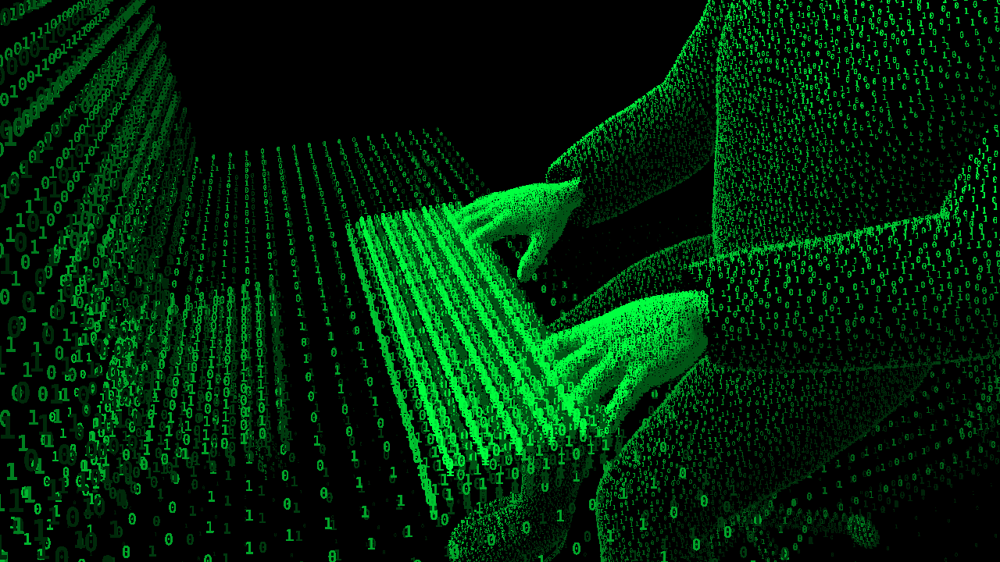

# Binary Mind Odyssey — revisione 3

Candidato per la valutazione artistica dell'utente. Il personaggio della revisione 2 è stato considerato non approvato e il suo metodo di costruzione è stato sostituito. Concept, estetica binaria, otto mondi, rivelazione della mente e frase finale sono conservati.

## Anteprima verificata

- [Scarica l'applicazione HTML autonoma](https://github.com/Tire-C/Tire-C/raw/6056992c8c613479d150b26bbc5842c1c493b0b8/odyssey/review/odyssey.html).
- [Sorgenti verificati](https://github.com/Tire-C/Tire-C/tree/7029ce51cd7df005ad24e1101d81333876cfb1e3/odyssey/src), [generatore anatomico](tools/prepare-character.py).
- [Esecuzione cloud conclusa](https://github.com/Tire-C/Tire-C/actions/runs/43660581170).
- [Rapporto dei test](https://github.com/Tire-C/Tire-C/blob/6056992c8c613479d150b26bbc5842c1c493b0b8/odyssey/diagnostics/report.json), [galleria diagnostica](diagnostics/README.md).

Il collegamento dell'applicazione scarica un singolo HTML da aprire nel browser per osservarlo. Non richiede installazioni, server o build. GitHub non lo serve come sito interattivo; Pages non è stato attivato. L'applicazione contiene il programma WebGL e i dati spaziali, non video, GIF o sequenze di immagini.

Source SHA: `7029ce51cd7df005ad24e1101d81333876cfb1e3`. Output verificato: `6056992c8c613479d150b26bbc5842c1c493b0b8`. La documentazione successiva non modifica il codice dell'anteprima.

## Nuovo personaggio

La revisione 2 costruiva viso e corpo mediante superfici parametriche progettate manualmente. Rendeva difficile ottenere anatomia e raccordi convincenti. Questa revisione parte invece da topologia anatomica, morph e pesi scheletrici degli **asset grafici MakeHuman, CC0-1.0**, fissati a un commit e verificati per hash. La [licenza ufficiale](https://github.com/makehumancommunity/makehuman/blob/a8bc2d54ff0ac92e78ff71431b1023eda42bf482/LICENSE.md) distingue gli asset dal codice del programma: non viene incorporato né eseguito il software MakeHuman AGPL.

La base è configurata come giovane adulto maschile afrodiscendente, senza riferimento a una persona reale specifica. Posa, abbigliamento, capelli, campionamento e collegamento con la scena sono elaborati da codice originale:

- Scheletro articolato e cinematica inversa per braccia e gambe; polsi allineati alla tastiera, gomiti leggermente aperti, ginocchia piegate e piedi davanti alla seduta.
- Inclinazione progressiva di torso, collo e testa verso lo schermo; spalle, bacino e cranio mantengono proporzioni anatomiche.
- Mani anatomiche con orientamento dei palmi e flessione delle dita. Glifi più piccoli su mani e collo conservano il dettaglio.
- Topologia continua di volto, mandibola, orecchie e naso; globi oculari campionati, con luminosità differenziata per iride e pupilla.
- Capelli corti a ricci tridimensionali, abbigliamento ampio senza marchi, pieghe contenute e sneakers.
- Suddivisione delle superfici e campionamento spaziale deterministico. Testa: 21.720 campioni; corpo con calzature: 38.056. Sono dati geometrici, non una misura della qualità artistica.

Le superfici anatomiche non vengono disegnate come mesh visibili. Solo i glifi 0/1 scrivono colore. Due geometrie invisibili scrivono esclusivamente la profondità per impedire che i glifi del lato posteriore attraversino viso e corpo. La loro apertura e dissolvenza sono sincronizzate con rivelazione e morph finale.

La camera è ricalibrata sul nuovo cranio: l'universo, presente al suo interno per tutto il viaggio, ha raggio massimo 0,0816 unità. L'apertura temporanea della calotta lascia osservare la continuità spaziale; successivamente il volto si ricompone.

| Revisione 2, personaggio non approvato | Revisione 3 |
|---|---|
|  |  |

Queste immagini documentano il rendering reale eseguito nel runner. Non vengono usate dalla riproduzione.

## Elementi dinamici

Un nuovo passaggio instanziato calcola piccoli gruppi di glifi in movimento nello stesso spazio tridimensionale dei mondi. La densità resta limitata a 264–506 istanze per ambiente, contro le 28.000 del soggetto principale.

| Ambiente | Movimento aggiunto |
|---|---|
| Immersione | Pacchetti elicoidali lungo le pareti del tunnel |
| Programmazione | Transito sui bus e sui collegamenti verticali dell'architettura |
| Fisica | Pacchetti lungo le orbite atomiche, solidali con la loro rotazione |
| Chimica | Flussi che risalgono le due eliche molecolari |
| Matematica | Campioni mobili lungo la superficie toroidale |
| Astronomia | Frammenti in orbita sull'anello planetario e nel disco |
| Intelligenza artificiale | Impulsi sulle connessioni effettive tra gli strati neurali |
| Ingegneria | Segnali sugli alberi e riferimenti sui bordi degli ingranaggi, sincronizzati con i meccanismi |

Percorsi, dissolvenze e luminosità sono deterministici. Le aggiunte si attenuano durante le transizioni e la rivelazione, mantenendo la gerarchia dei soggetti. Il confronto a camera e mondo principale immobili rileva movimento nei pixel di tutti e otto gli ambienti.

## Ritmo

Durata totale: **24 secondi**, rispetto ai 28 della revisione 2.

- Viaggio, rivelazione e composizione della firma: 20,5 s, prima 24 s; progressione circa **17,1% più veloce**.
- Firma esatta **Hi, I am Tire** completamente composta da 20,5 a 23,5 s: **3 s di lettura**.
- Dissolvenza finale: 0,5 s.

Il percorso interno e i generatori degli otto mondi approvati sono preservati; cambia la mappatura del tempo, mentre il tratto esterno della camera segue le nuove proporzioni del personaggio. Il passaggio dal creatore alla firma conserva dimensioni, identità, densità e luminosità dei glifi.

## Verifica tecnica e osservazione

**56 controlli superati, nessun fallimento**, nella versione indicata sopra. La suite acquisisce 28 momenti della timeline, quattro studi del personaggio, tre viste orbitali, due inquadrature verticali e confronti browser.

Verificati: geometrie realmente XYZ; generatori scientifici originali invariati; camera continua; seek deterministico; shader senza errori; solo glifi come geometria visibile; movimento secondario isolato in tutti i mondi; riproduzione e pausa; ispezione 3D e ritorno all'inquadratura esatta; reduced motion; funzionamento HTML senza richieste di rete; margini della firma. Il raccordo creatore/firma misura **zero differenza media di canale verde** immediatamente prima e dopo il cambio di passaggio. Massimo sette draw call, incluse le due passate invisibili di profondità.

L'ispezione delle acquisizioni ha riguardato volto frontale, tre quarti e profilo, mani e postura alla tastiera, corpo seduto, apertura della calotta, mondi e firma desktop/verticale. Durante le iterazioni sono stati corretti contrasto del volto, occlusione degli occhi, dimensione dei glifi delle mani e discontinuità luminosa all'ingresso nel morph. Il profilo e la silhouette risultano anatomicamente più credibili della precedente costruzione parametrica; l'accettazione artistica rimane dell'utente.

## Ambiente e limiti

Preparazione anatomica, installazioni, build, test e acquisizioni sono avvenuti esclusivamente su **GitHub Actions, runner standard pubblico ubuntu-24.04**. Nessuna build o sviluppo sul PC dell'utente, nessun runner a pagamento, servizio acquistato, fatturazione, Pages o hosting esterno attivato.

**I test sono di rendering software su CPU remota, non su GPU fisica.**

- Chromium: ANGLE SwiftShader. Benchmark con lettura dei pixel: mediana 361,2 ms, p95 419,8 ms per campione. Non è fluido e non misura gli FPS della GPU dello spettatore.
- Firefox: scena del creatore renderizzata con llvmpipe/Xvfb.
- WebKit: scena del creatore renderizzata nel runner Linux. La stringa esposta “Apple GPU” non è prova di una GPU fisica o di hardware Apple.
- Suite completa in Chromium; sugli altri motori è verificata la scena del creatore. Non è una certificazione di ogni browser/dispositivo.

Durante l'osservazione il browser dello spettatore usa la propria implementazione WebGL. Le prestazioni su hardware reale restano da verificare. Il personaggio conserva la natura di scultura binaria: nella vista completa e soprattutto su un display verticale piccolo i lineamenti perdono dettaglio. L'ispezione 3D permette di avvicinarsi. Non si dichiara raggiunto un realismo fotografico o approvato il risultato artistico.

Il test SVG continua a mostrare animazione dichiarativa nel vero Markdown GitHub, senza JavaScript. Questo verifica solo SMIL di base; non permette di incorporare il motore WebGL nel README. Nessun sostituto SVG è stato pubblicato sul profilo. Le note generiche del rapporto automatico che richiedono osservazione mobile/SVG vanno lette insieme ai risultati del test e all'ispezione descritta qui.

## Protezione del profilo e ripristino

Il lavoro riguarda esclusivamente `work/binary-mind-odyssey`. Baseline all'inizio della revisione 3: `7be1854ab42746e44c26a4f7d071c786fffc4ccf`.

- Main invariato: `0f00154f3651c7bed8cf8660780bb3c1750ed9bc`.
- Blob README originale: `1d0114fe01e78f186042fc760e37b66d6cf9c090`.
- SHA-256 README: `f1abfb3998faf6b417398d8755de720779cc0b874e667d113a4134c207673b3e`.
- [Copia originale verificata](audit/README.original.md).

Nessun ripristino del profilo è necessario. Per annullare questa revisione si prepara sul branch sperimentale un commit inverso del diff rispetto alla baseline sopra, confrontando prima eventuali modifiche successive e limitandolo ai file della revisione; si rieseguono quindi i test cloud. Niente reset, force-push o sovrascrittura di lavori successivi.

L'inserimento nel profilo e un eventuale hosting restano subordinati ad approvazione separata. La [procedura di aggiunta minima e ripristino](integration/PROPOSAL.md) conserva tutti i byte del README esistente e usa un commit dedicato reversibile.
