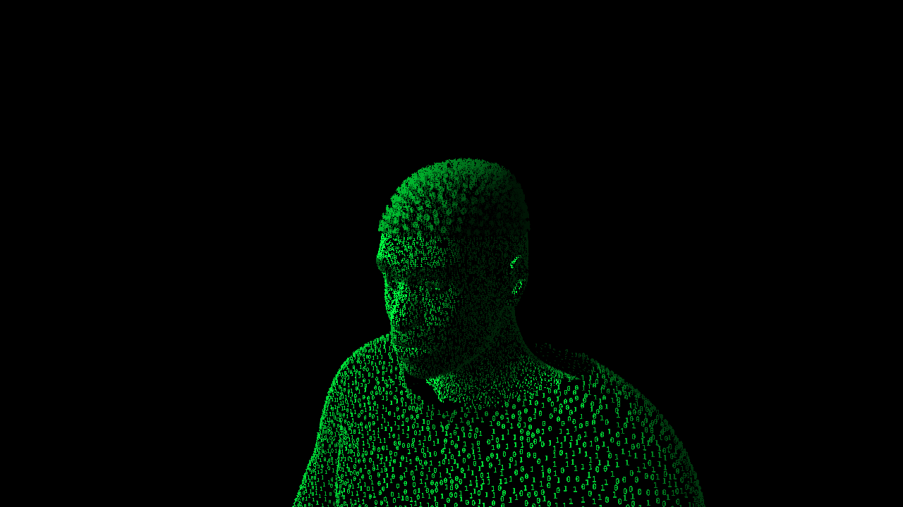
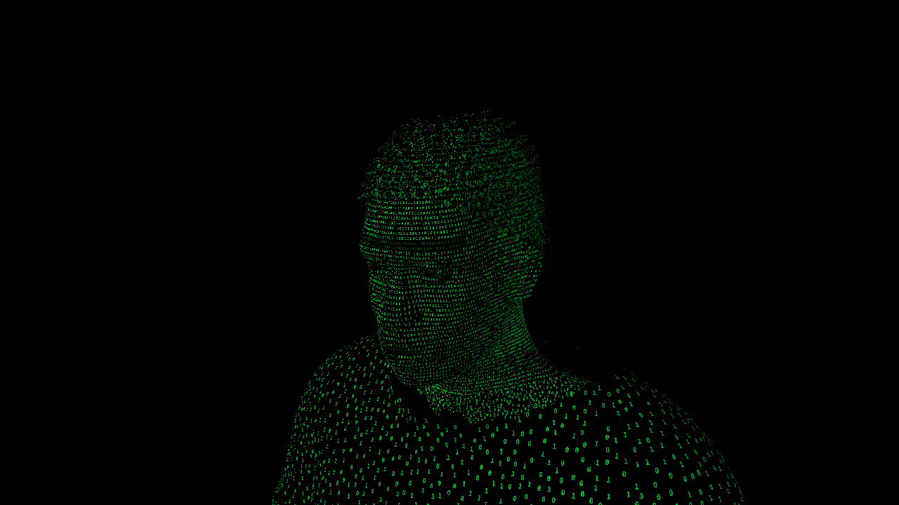
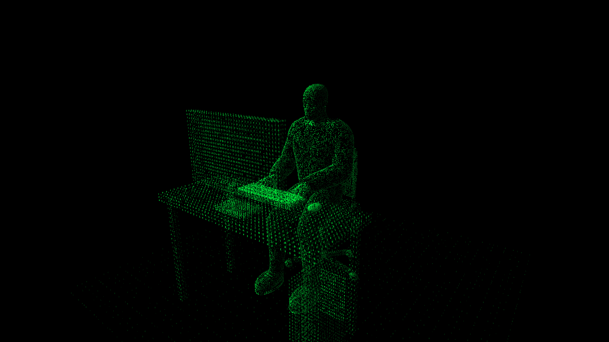
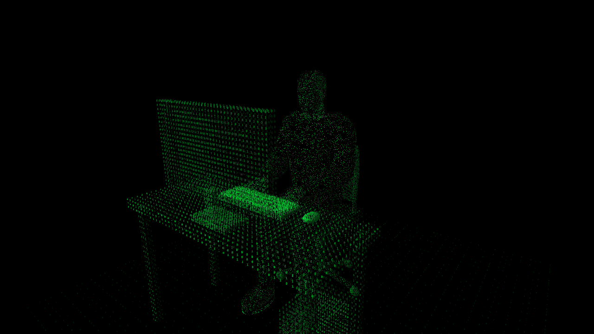
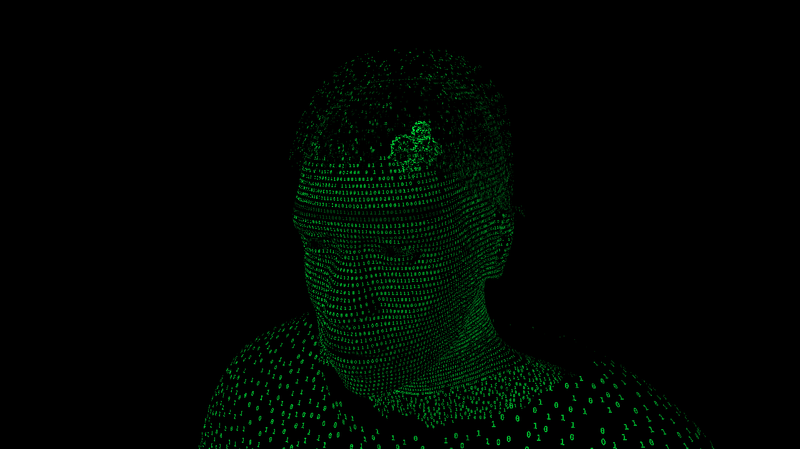
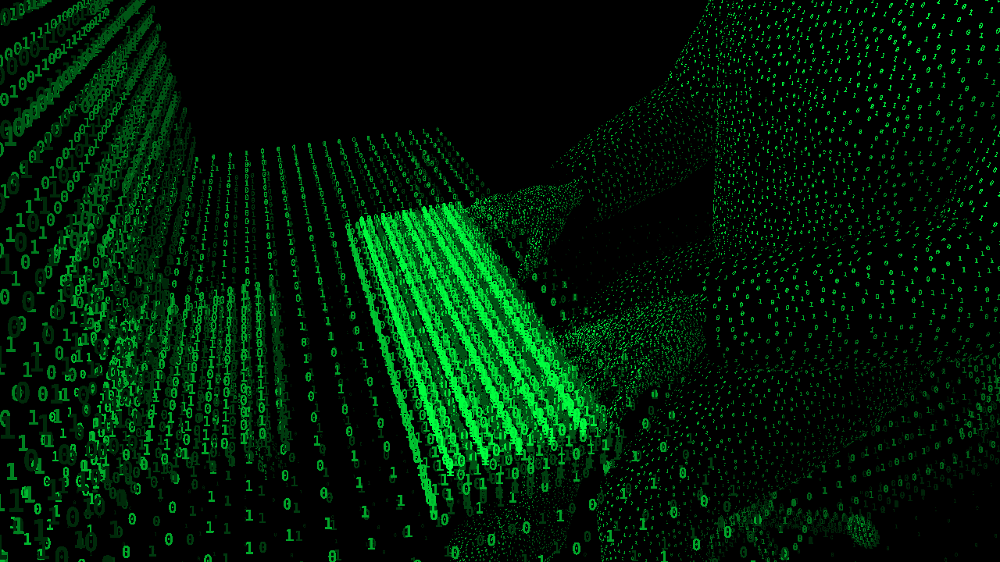
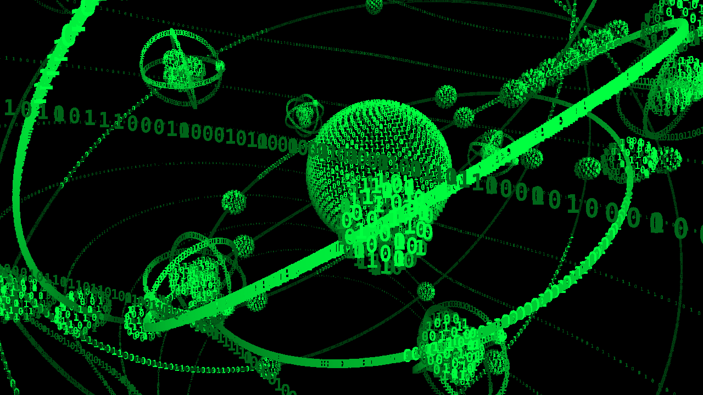
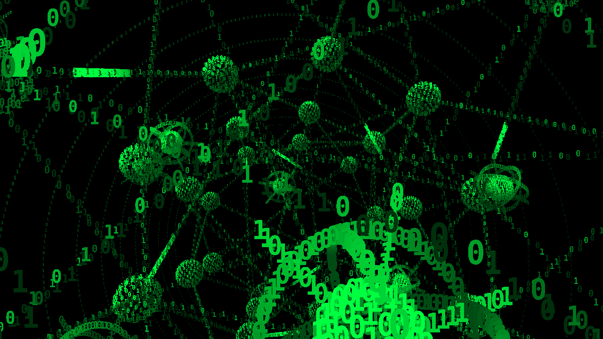

# Binary Mind Odyssey — revisione 4

Nuovo candidato per la valutazione artistica. La revisione 3, compreso il suo personaggio, è considerata non approvata. Concept, verde su nero, mondi originali, rivelazione e firma sono conservati.

## Anteprima

- [Scarica il programma HTML autonomo](https://github.com/Tire-C/Tire-C/raw/8ebe01b24c3cf3e1557ac7a9adb98393040985f0/odyssey/review/odyssey.html).
- [Codice verificato](https://github.com/Tire-C/Tire-C/tree/ea39297353cda40293c4236ab26860a1eb26efc0/odyssey/src).
- [Test cloud](https://github.com/Tire-C/Tire-C/actions/runs/43753898633), [rapporto strutturato](https://github.com/Tire-C/Tire-C/blob/8ebe01b24c3cf3e1557ac7a9adb98393040985f0/odyssey/diagnostics/report.json).
- [Acquisizioni della timeline](diagnostics/README.md).

Aprire il singolo HTML nel browser per osservare il programma. Non servono installazioni, build o server. GitHub distribuisce il file come download; non viene dichiarato disponibile un sito ospitato. Pages rimane disattivato.

Source SHA: `ea39297353cda40293c4236ab26860a1eb26efc0`. Output SHA: `8ebe01b24c3cf3e1557ac7a9adb98393040985f0`. Le immagini riportate sotto sono diagnostica remota: nessuna viene utilizzata per riprodurre l'animazione.

## Figura umana: cambio del metodo di rappresentazione

La base anatomica CC0 della revisione 3 è riutilizzata, ma il suo campionamento casuale del volto e il sistema di resa sono sostituiti. La revisione precedente sovrapponeva piccoli glifi, perdendo lineamenti e sguardo.

La nuova costruzione usa **microtipografia orientata sulla superficie anatomica**: intersezioni di raggi con il cranio, la pelle e gli occhi producono file regolari di centri XYZ; ogni glifo segue la normale locale. La spaziatura rispetta le proporzioni del carattere monospaziato. Non è un filtro bidimensionale applicato all'immagine.

Gli occhi non derivano più dalle sfere ausiliarie dello scheletro. Viene adattata la geometria oculare dettagliata MakeHuman, con 1.064 vertici, usando la sua mappatura dichiarativa sulla testa morfizzata. Un campionamento più fitto genera 296 microglifi nelle aperture oculari; iride, pupilla e sclera hanno luminosità distinte. L'apertura delle palpebre è regolata mediante morph simmetrici.

Sei campi di profondità calcolati sul runner stimano la visibilità della luce nei recessi di palpebre, naso, bocca e orecchie. Nel programma rimangono soltanto coefficienti per glifo, non immagini prerenderizzate. Illuminazione direzionale, luce di riempimento e compressione delle alte luci mantengono le variazioni del volto senza saturarle in verde uniforme.

Il corpo usa glifi orientati, con spaziatura ricalibrata per abiti e mani. Rimangono l'anatomia articolata, la posa mediante cinematica inversa, le dita sulla tastiera, i capelli corti ricci e l'abbigliamento originale senza marchi. La luminosità del personaggio è rafforzata rispetto alla postazione.

L'inquadratura del ritratto segue lo sguardo rivolto allo schermo. La calotta si ricompone prima dell'allontanamento, lasciando vedere il volto completo nella sequenza effettiva. L'universo rimane geometricamente dentro il cranio e visibile durante la prima parte della rivelazione.

Solo glifi 0/1 scrivono colore. Le due geometrie anatomiche di occlusione restano invisibili, con `colorWrite:false`. Nessuna mesh tradizionale visibile, fotografia o volto di una persona specifica.

Gli undici file sorgente sono fissati per commit e hash nel [manifest](assets/makehuman-manifest.json). Sono asset grafici [MakeHuman CC0](https://github.com/makehumancommunity/makehuman/blob/a8bc2d54ff0ac92e78ff71431b1023eda42bf482/LICENSE.md); il codice AGPL del programma MakeHuman non è incorporato. Adattamento, posa, campionamento, illuminazione e animazione sono codice del progetto.

| Revisione 3, non approvata | Revisione 4 |
|---|---|
|  |  |
|  |  |

## Densità e attività in tutti i mondi

I generatori originali degli otto mondi sono verificati identici. Un nuovo passaggio instanziato aggiunge **60 gruppi mobili per mondo**, distribuiti su tre livelli di profondità: 16, 20 e 24 gruppi. Comprendono oggetti completi e attraversamenti direzionali; non sono una texture di particelle sovrapposta allo schermo.

| Mondo | Strutture e movimento aggiunti | Glifi del nuovo passaggio |
|---|---|---:|
| Immersione | Costole mobili, pacchetti elicoidali e attraversamenti lungo il tunnel | 7.221 |
| Programmazione | Blocchi di dati, moduli di instradamento e traffico verticale fra le strutture | 12.501 |
| Fisica | Nuclei satelliti e sistemi orbitali distribuiti nel volume | 17.880 |
| Chimica | Molecole tetraedriche rotanti, legami e flussi intorno alla doppia elica | 12.270 |
| Matematica | Strutture cubiche annidate in rotazione e campioni lungo le superfici | 14.910 |
| Astronomia | Corpi orbitali, anelli e attraversamenti direzionali nel campo stellare | 12.798 |
| Intelligenza artificiale | Corone neuronali, gruppi di elaborazione e impulsi sulle connessioni | 16.461 |
| Ingegneria | Gruppi di ingranaggi, alberi e traffico lungo le trasmissioni | 19.068 |

I flussi introdotti in R3 sono inoltre più presenti e veloci, con 636–1.232 glifi per mondo. Le traiettorie degli oggetti, la loro rotazione e le loro dissolvenze sono deterministiche. I limiti spaziali dell'intero movimento sono verificati all'interno del volume cranico.

Il test congela camera e mondo principale e fa avanzare soltanto le strutture aggiuntive. In ciascuno degli otto ambienti cambiano oltre 21.000 pixel; il confronto con le aggiunte disattivate rileva oltre 18.000 pixel di contributo. Le inquadrature campionate occupano 11 o 12 delle 12 regioni di controllo. Sono indicatori di presenza e movimento effettivi, non un voto estetico o la prova che ogni istante sia privo di spazi neri.

## Ritmo: 16 secondi

La durata scende da 24 a **16 secondi**, un terzo in meno. Cambia anche il percorso: avvicinamenti più pronunciati, passaggi fra le strutture, inclinazioni della camera e variazioni continue dell'angolo di campo aumentano parallasse e slancio.

| Parte | R3 | R4 |
|---|---:|---:|
| Otto mondi | 11,71 s | 8,8 s |
| Rivelazione della mente | 4,39 s | 2,6 s |
| Creatore e postazione | 2,20 s | 1,8 s |
| Composizione della firma | 2,20 s | 1,0 s |
| Firma completamente leggibile | 3,0 s | 1,5 s |
| Dissolvenza | 0,5 s | 0,3 s |

La frase finale resta esattamente **Hi, I am Tire**. `prefers-reduced-motion` avvia la scena del creatore in pausa, senza moto automatico.

## Test, osservazione e limiti

**58 controlli superati, nessun fallimento** sulla sorgente indicata. Acquisiti 28 momenti della timeline, confronti con/senza attività in tutti gli otto mondi, coppie a camera ferma, studi del volto e delle mani, viste orbitali, formato verticale e scena del creatore su tre motori browser.

Verificati continuità della camera, determinismo dei pixel, geometrie realmente tridimensionali, confinamento delle strutture nel cranio, invisibilità delle mesh di occlusione, otto passate al massimo, raccordo creatore/firma, pausa, ispezione orbitale e funzionamento senza rete. La differenza media di canale verde al cambio di passaggio verso la firma è 0.

L'ispezione visiva comprende tutti gli otto ambienti e confronti del loro movimento, volto frontale/di tre quarti/di profilo, mani, ritratto nella sequenza, personaggio completo, rivelazione e firma desktop/verticale. Questa osservazione è basata sui pixel effettivamente renderizzati in cloud, non sul solo caricamento della pagina.

Tutto lo sviluppo eseguibile, la generazione anatomica, le dipendenze, build, test e acquisizioni sono avvenuti su **GitHub Actions, runner standard pubblico ubuntu-24.04**, senza costi o uso del PC dell'utente per sviluppo. Nessun servizio a pagamento, fatturazione o Pages attivato. La gratuità dei runner standard nei repository pubblici è confermata dalla [documentazione GitHub](https://docs.github.com/en/actions/how-tos/write-workflows/choose-where-workflows-run/choose-the-runner-for-a-job); il workflow non carica artifact o cache a pagamento.

**Rendering software su CPU remota; GPU fisica non verificata.** Chromium usa ANGLE SwiftShader: mediana 364,8 ms, p95 410,9 ms per campione con lettura dei pixel. Questi tempi non sono fluidi e non misurano le prestazioni della GPU dello spettatore. Firefox e WebKit hanno renderizzato la scena del creatore; la suite completa riguarda Chromium. La stringa “Apple GPU” esposta da WebKit nel runner Linux non viene considerata prova di hardware Apple.

Il personaggio resta una rappresentazione binaria, con perdita di dettaglio del volto nelle viste lontane e sugli schermi piccoli. La nuova densità e il ritmo intenso richiedono una valutazione personale dell'equilibrio visivo. Non si dichiarano fotorealismo, fluidità su hardware non provato o approvazione artistica definitiva.

Il test SVG nel vero README GitHub continua a verificare soltanto l'animazione dichiarativa di base. Non permette di incorporare questo motore WebGL nel README e non viene usato come sostituto dell'opera.

## Protezione e ripristino

Branch esclusivo: `work/binary-mind-odyssey`. Baseline R4: `82af2c5fd2cde5b0dcc4b463ef30f162ffcf59f2`.

Main rimane `0f00154f3651c7bed8cf8660780bb3c1750ed9bc`; README del profilo e [copia originale](audit/README.original.md) mantengono il blob `1d0114fe01e78f186042fc760e37b66d6cf9c090`, con SHA-256 `f1abfb3998faf6b417398d8755de720779cc0b874e667d113a4134c207673b3e`.

Per annullare la revisione, preparare un commit inverso limitato al suo diff rispetto alla baseline, confrontando prima eventuali lavori successivi e rieseguendo i test cloud. Non usare reset o force-push. Il profilo non necessita di ripristino perché non è stato modificato.

Qualsiasi integrazione o hosting richiede approvazione separata. La [procedura già predisposta](integration/PROPOSAL.md) aggiunge soltanto il blocco approvato, conserva ogni byte preesistente e registra un commit dedicato reversibile.
