# Rendering diagnostics — review candidate

Source commit: 6e1e89783fe7339a984d1c4b972a3db8e8d02b20

Remote CPU rendering with Chromium / SwiftShader. These images are test evidence, never the animation product.

- PASS Approved scientific worlds preserved exactly
- PASS Revised duration with preserved final hold
- PASS README is byte-for-byte identical to baseline
- PASS README original blob
- PASS Verified backup
- PASS Camera continuity and finite coordinates over the complete revised timeline
- PASS Final phrase exact and held for 3.5 seconds
- PASS Eight genuine 3D environments inside the head
- PASS Software rendering explicitly identified
- PASS Frame 0 contains monochrome rendered geometry
- PASS Frame 0.5142857142857142 contains monochrome rendered geometry
- PASS Frame 0.8571428571428571 contains monochrome rendered geometry
- PASS Frame 1.3714285714285717 contains monochrome rendered geometry
- PASS Frame 2.2285714285714286 contains monochrome rendered geometry
- PASS Frame 3.9428571428571426 contains monochrome rendered geometry
- PASS Frame 5.657142857142857 contains monochrome rendered geometry
- PASS Frame 7.371428571428571 contains monochrome rendered geometry
- PASS Frame 9.085714285714285 contains monochrome rendered geometry
- PASS Frame 10.799999999999999 contains monochrome rendered geometry
- PASS Frame 12.514285714285714 contains monochrome rendered geometry
- PASS Frame 13.714285714285714 contains monochrome rendered geometry
- PASS Frame 14.571428571428571 contains monochrome rendered geometry
- PASS Frame 15 contains monochrome rendered geometry
- PASS Frame 15.428571428571429 contains monochrome rendered geometry
- PASS Frame 15.857142857142858 contains monochrome rendered geometry
- PASS Frame 16.285714285714285 contains monochrome rendered geometry
- PASS Frame 16.714285714285715 contains monochrome rendered geometry
- PASS Frame 17.142857142857142 contains monochrome rendered geometry
- PASS Frame 17.571428571428573 contains monochrome rendered geometry
- PASS Frame 18 contains monochrome rendered geometry
- PASS Frame 18.428571428571427 contains monochrome rendered geometry
- PASS Frame 18.857142857142858 contains monochrome rendered geometry
- PASS Frame 20.571428571428573 contains monochrome rendered geometry
- PASS Frame 22.114285714285717 contains monochrome rendered geometry
- PASS Frame 23.142857142857142 contains monochrome rendered geometry
- PASS Frame 24.5 contains monochrome rendered geometry
- PASS Frame 26.5 contains monochrome rendered geometry
- PASS Random-access timeline is pixel deterministic
- PASS No JavaScript or shader errors
- PASS Instanced rendering uses at most five draw calls
- PASS Three spatial viewpoints produce distinct rendered images
- PASS Portrait signature has visible horizontal margins
- PASS Reduced motion starts paused on creator, no automatic motion
- PASS Standalone HTML works without network or installation
- PASS Interactive inspection rotates the 3D image
- PASS Returning from inspection restores the exact cinematic pose
- PASS Real-time playback advances the timeline
- PASS Pause freezes the timeline
- PASS Actual GitHub README SVG declarative animation changes pixels

## 0.00 s — Immersion

## 0.51 s — Immersion

## 0.86 s — Immersion

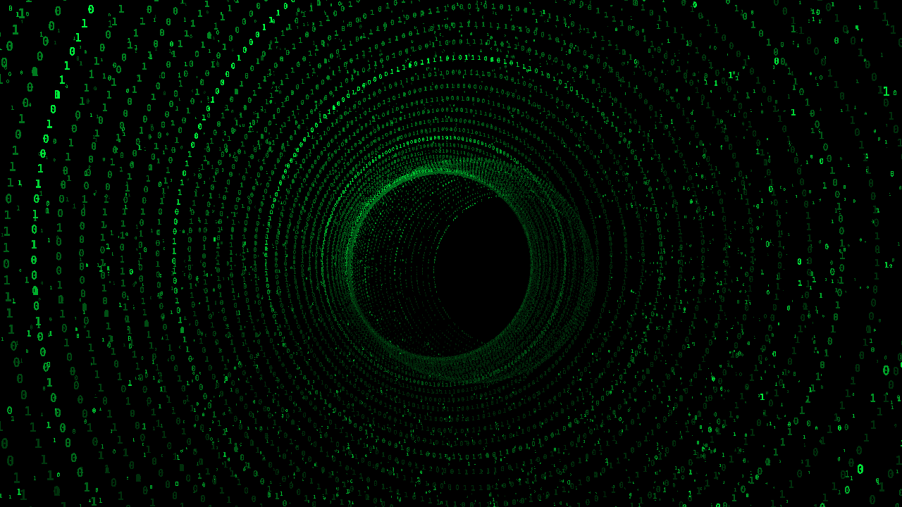

## 1.37 s — Immersion

## 2.23 s — Programming

## 3.94 s — Physics

## 5.66 s — Chemistry

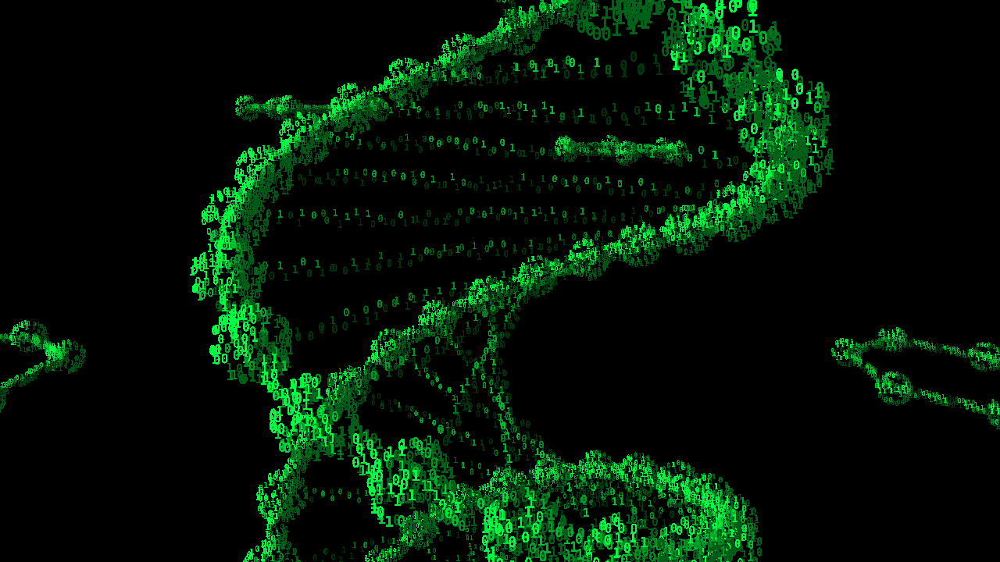

## 7.37 s — Mathematics

## 9.09 s — Astronomy

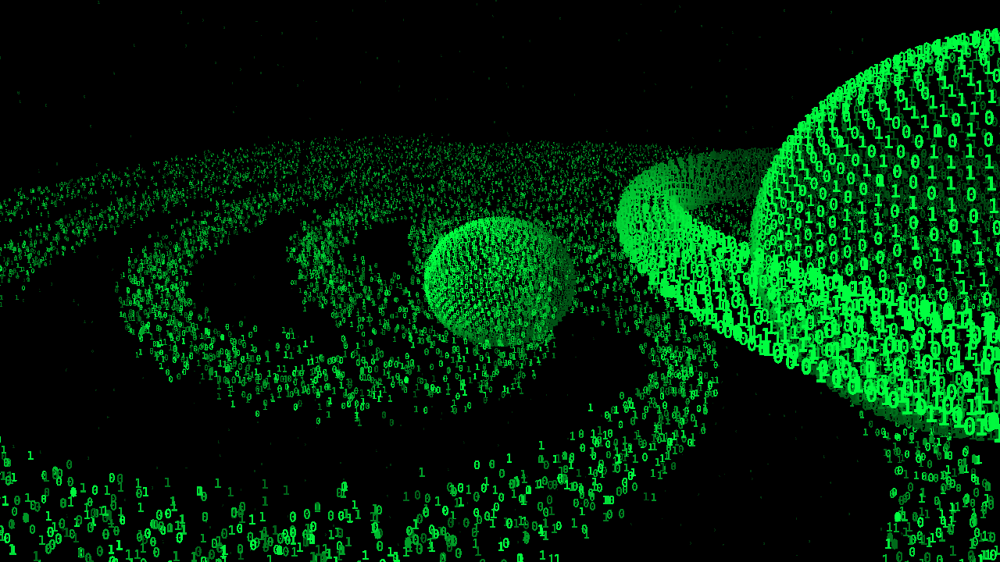

## 10.80 s — Intelligence

## 12.51 s — Engineering

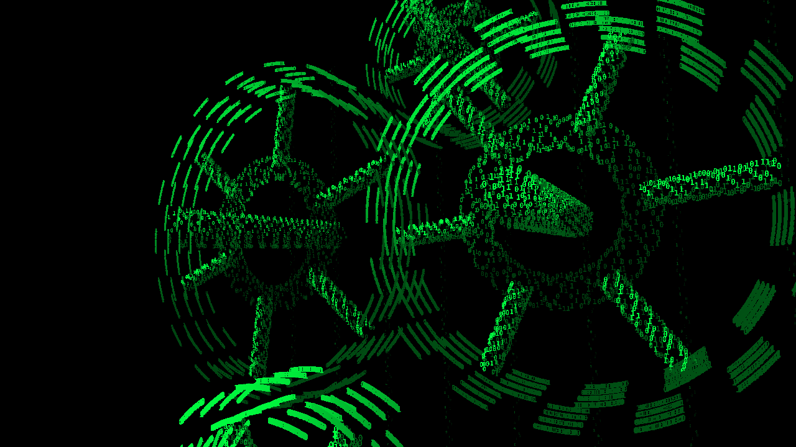

## 13.71 s — The mind

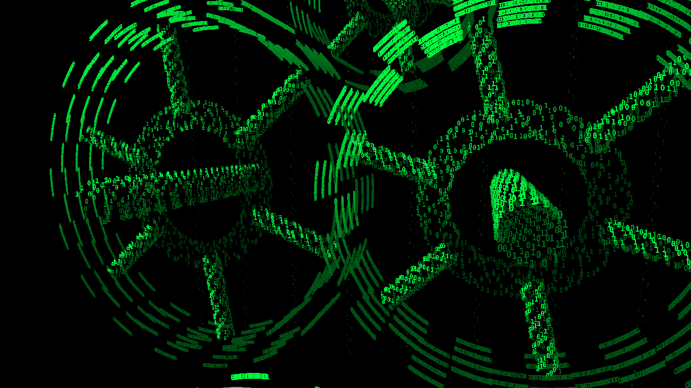

## 14.57 s — The mind

## 15.00 s — The mind

## 15.43 s — The mind

## 15.86 s — The mind

## 16.29 s — The mind

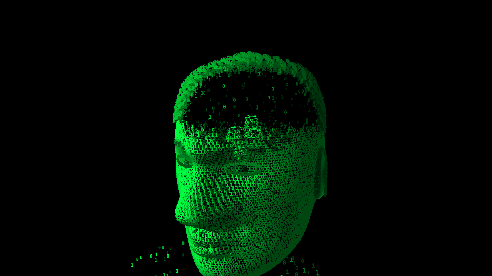

## 16.71 s — The mind

## 17.14 s — The mind

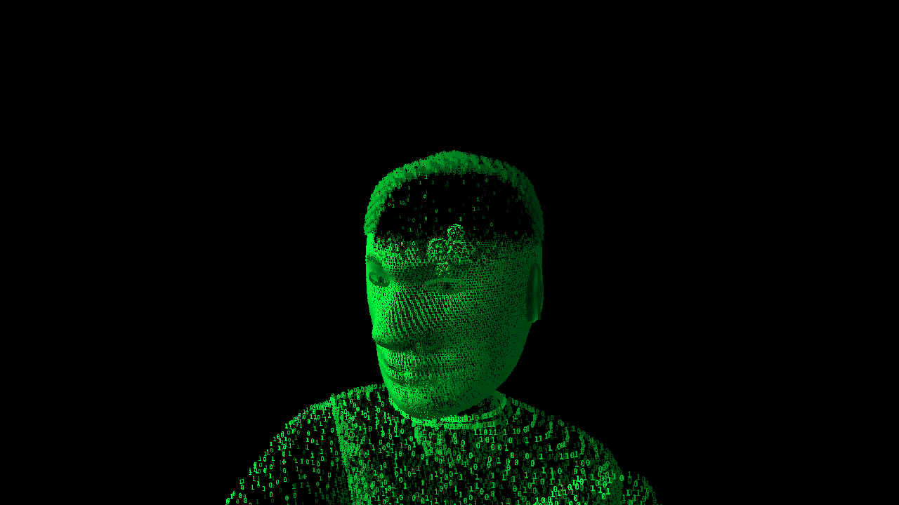

## 17.57 s — The mind

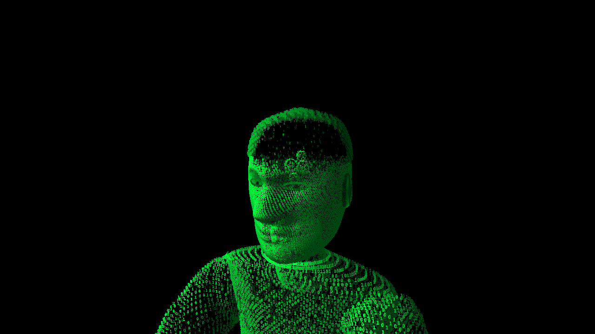

## 18.00 s — The mind

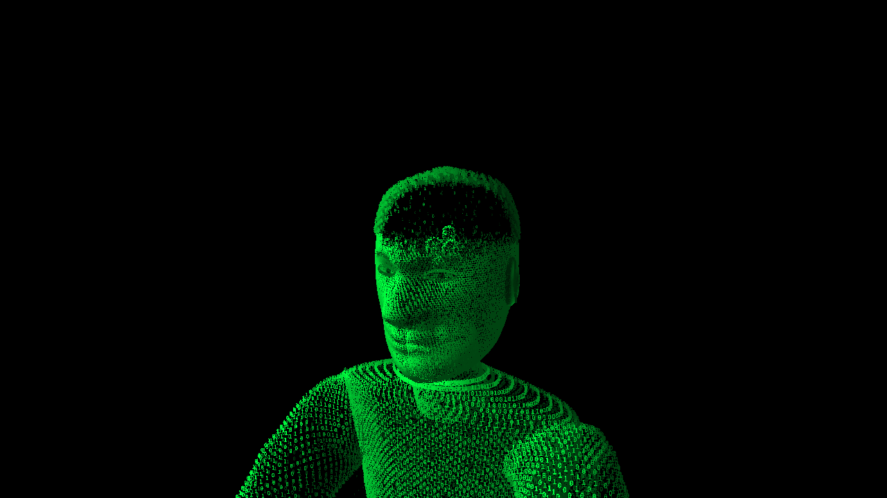

## 18.43 s — The mind

## 18.86 s — The creator

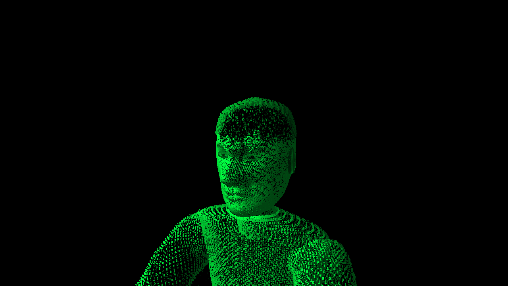

## 20.57 s — The creator

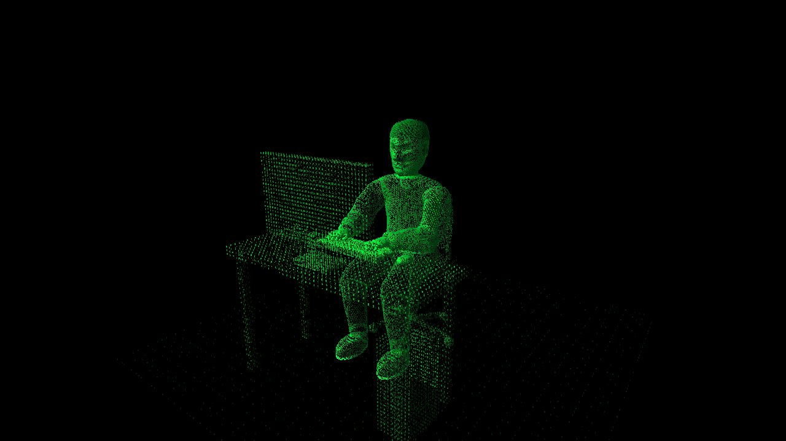

## 22.11 s — Hi, I am Tire

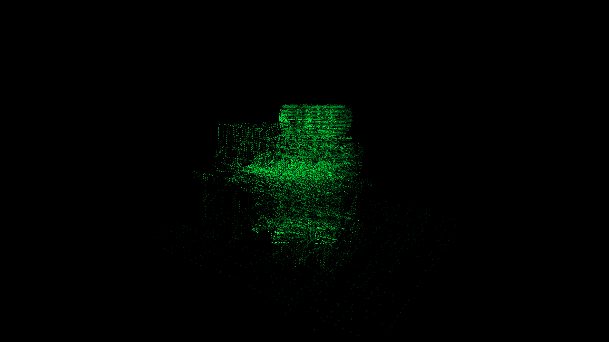

## 23.14 s — Hi, I am Tire

## 24.50 s — Hi, I am Tire

## 26.50 s — Hi, I am Tire

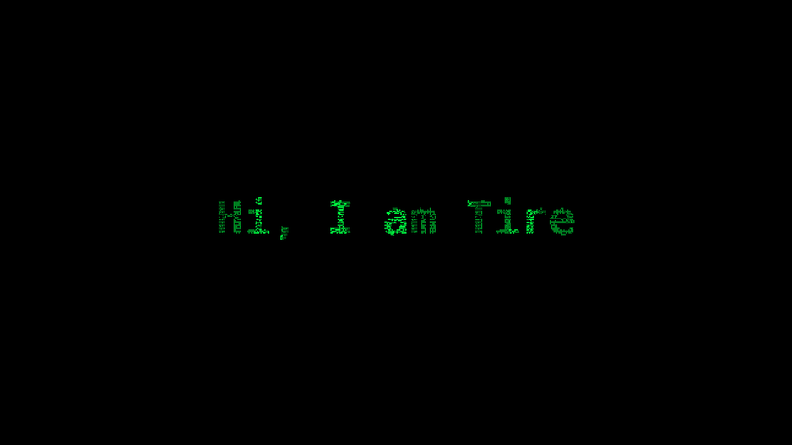

## Character study

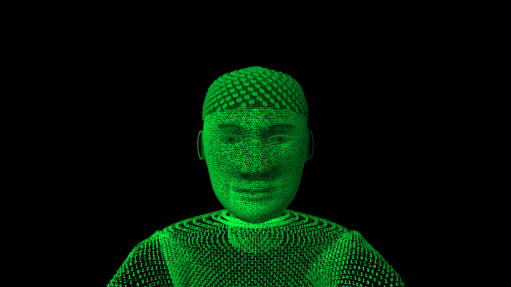

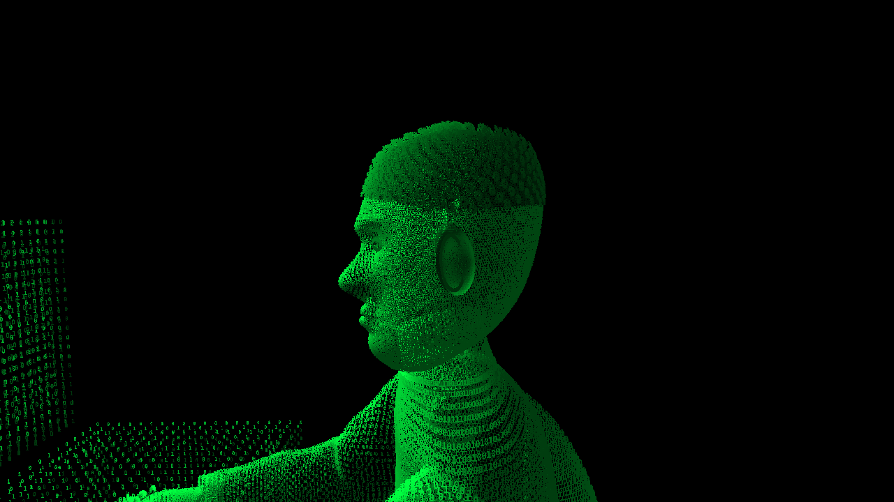

## Portrait checks

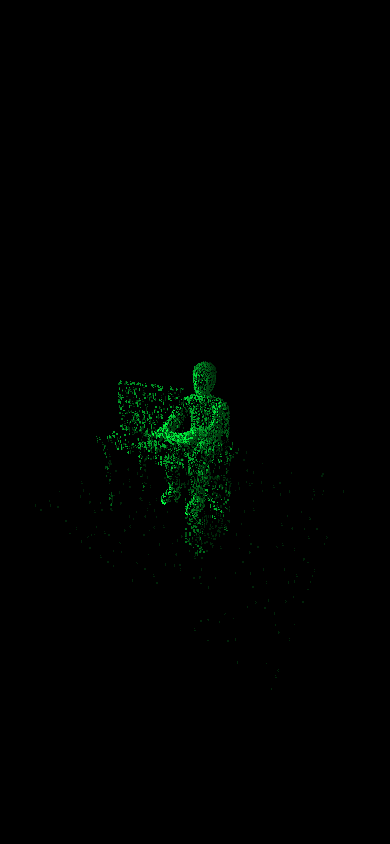

