# Rendering diagnostics — review candidate

Source commit: 80037349db39a4e41ace5b7075cad698bc1028f2

Remote CPU rendering with Chromium / SwiftShader. These images are test evidence, never the animation product.

- PASS README is byte-for-byte identical to baseline
- PASS README original blob
- PASS Verified backup
- PASS Camera continuity and finite coordinates over 3200 samples
- PASS Final phrase exact and held for 3.5 seconds
- PASS Eight genuine 3D environments inside the head
- PASS Software rendering explicitly identified
- PASS Frame 0 contains monochrome rendered geometry
- PASS Frame 1 contains monochrome rendered geometry
- PASS Frame 2.6 contains monochrome rendered geometry
- PASS Frame 4.6 contains monochrome rendered geometry
- PASS Frame 6.6 contains monochrome rendered geometry
- PASS Frame 8.6 contains monochrome rendered geometry
- PASS Frame 10.6 contains monochrome rendered geometry
- PASS Frame 12.6 contains monochrome rendered geometry
- PASS Frame 14.6 contains monochrome rendered geometry
- PASS Frame 16 contains monochrome rendered geometry
- PASS Frame 17.5 contains monochrome rendered geometry
- PASS Frame 19 contains monochrome rendered geometry
- PASS Frame 20.5 contains monochrome rendered geometry
- PASS Frame 22 contains monochrome rendered geometry
- PASS Frame 24 contains monochrome rendered geometry
- PASS Frame 25.8 contains monochrome rendered geometry
- PASS Frame 27 contains monochrome rendered geometry
- PASS Frame 28.5 contains monochrome rendered geometry
- PASS Frame 30.5 contains monochrome rendered geometry
- PASS Random-access timeline is pixel deterministic
- PASS No JavaScript or shader errors
- PASS Instanced rendering uses at most five draw calls
- PASS Reduced motion starts paused on creator, no automatic motion
- PASS Actual GitHub README SVG declarative animation changes pixels

## 0 s — Immersion

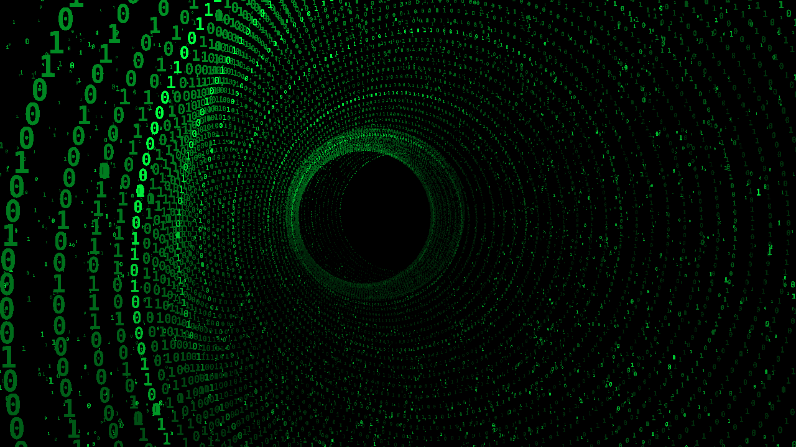

## 1 s — Immersion

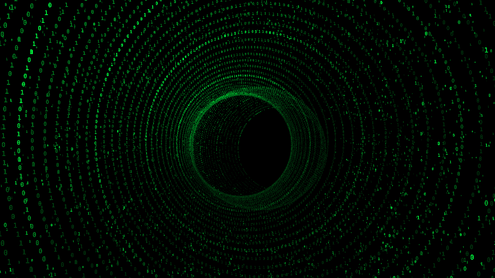

## 2.6 s — Programming

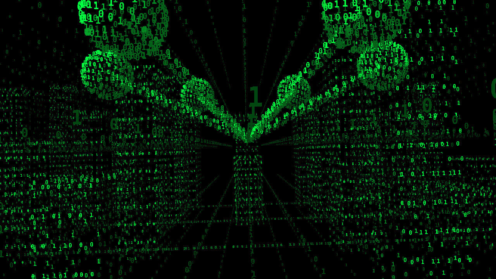

## 4.6 s — Physics

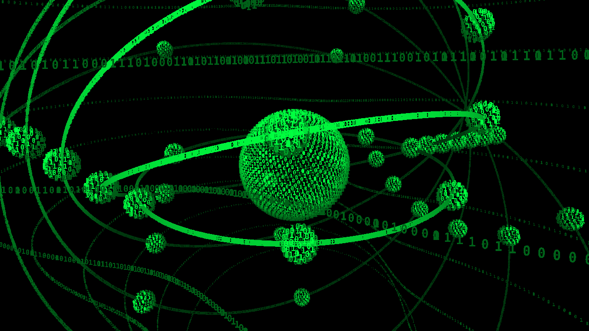

## 6.6 s — Chemistry

## 8.6 s — Mathematics

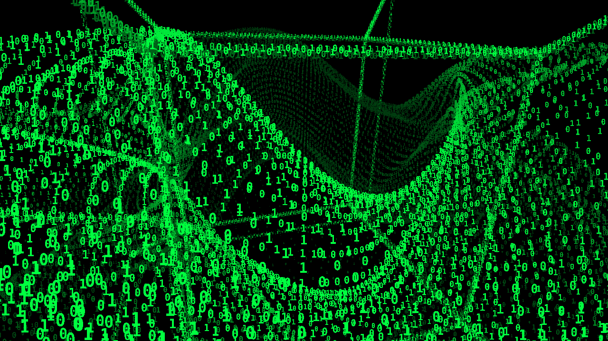

## 10.6 s — Astronomy

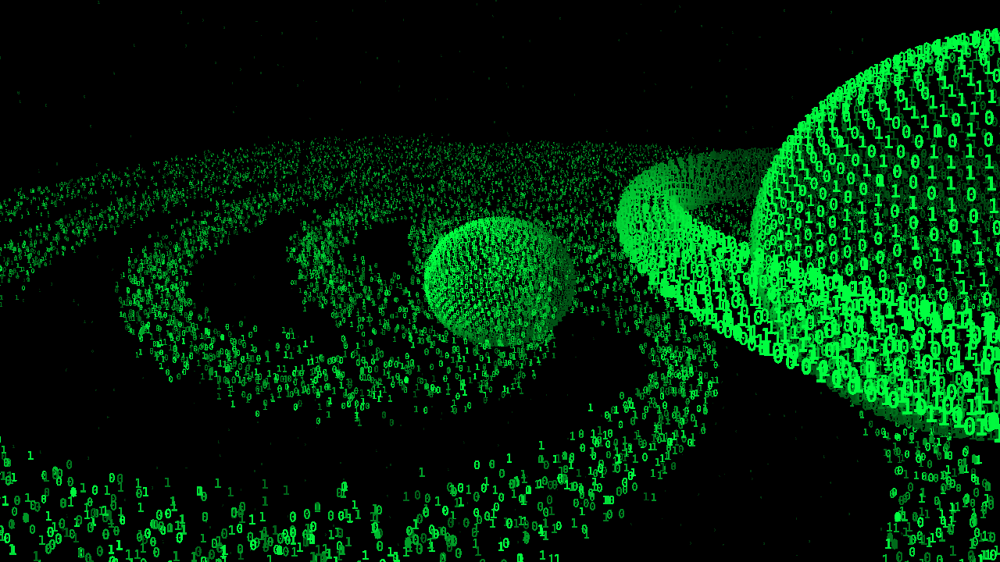

## 12.6 s — Intelligence

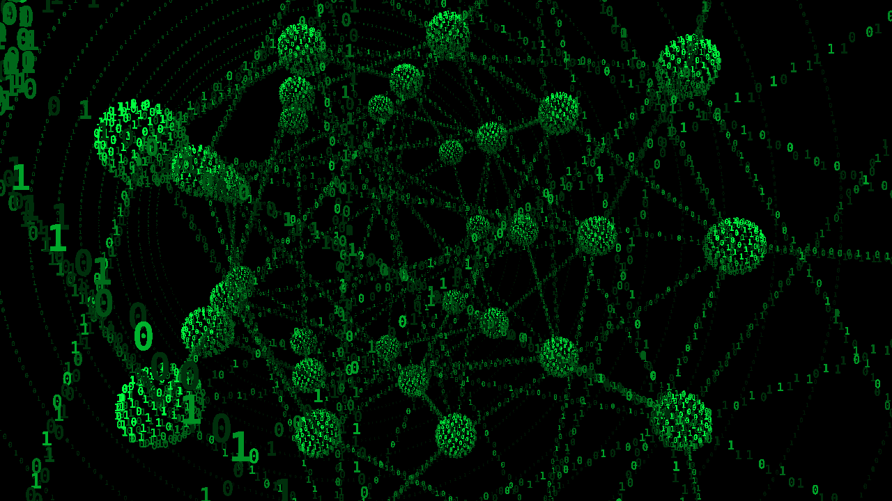

## 14.6 s — Engineering

## 16 s — The mind

## 17.5 s — The mind

## 19 s — The mind

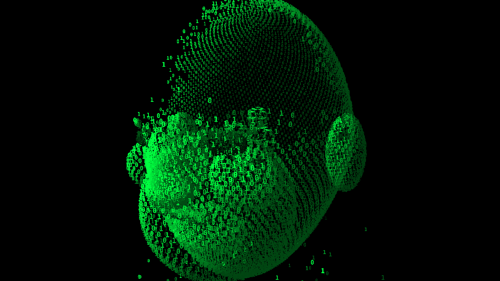

## 20.5 s — The mind

## 22 s — The creator

## 24 s — The creator

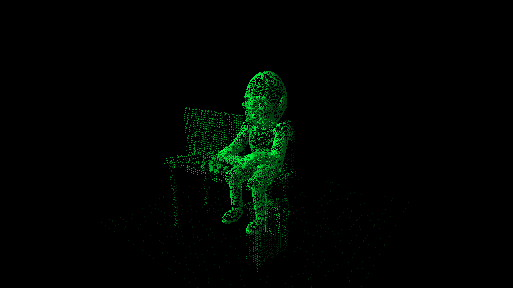

## 25.8 s — Hi, I am Tire

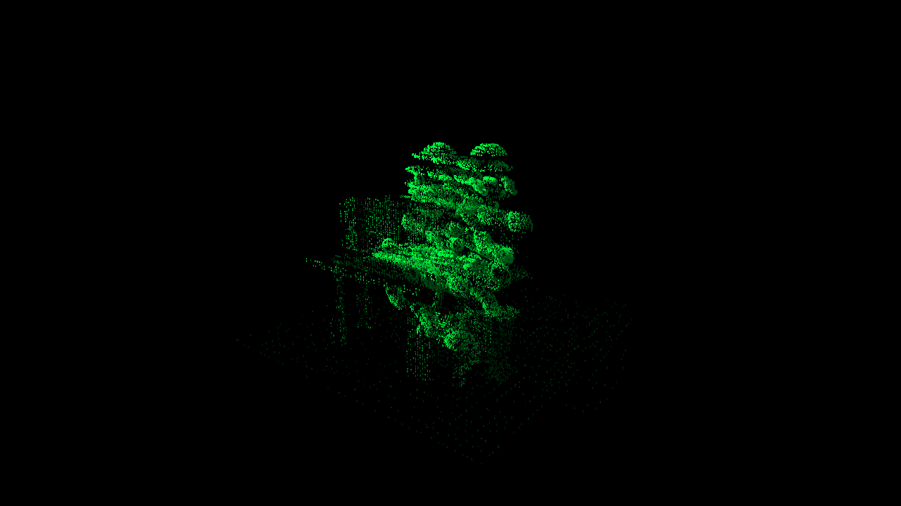

## 27 s — Hi, I am Tire

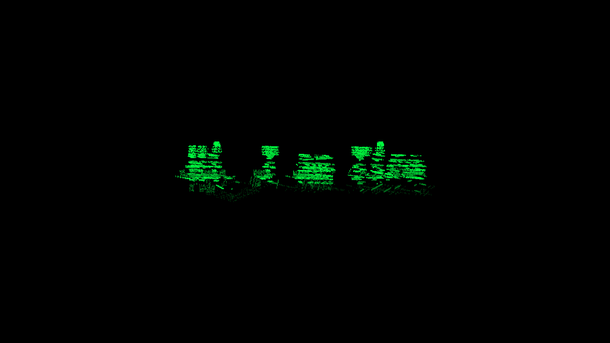

## 28.5 s — Hi, I am Tire

## 30.5 s — Hi, I am Tire

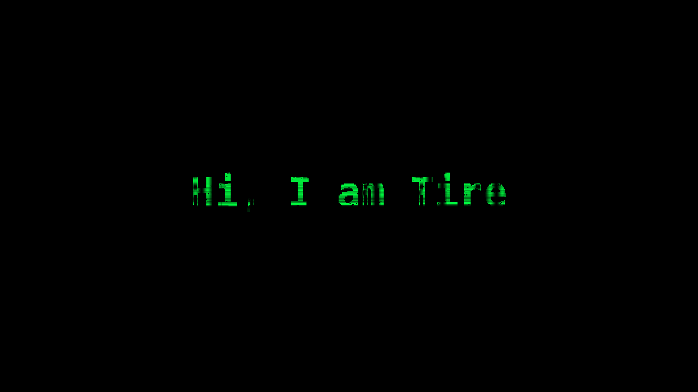

## Portrait checks

